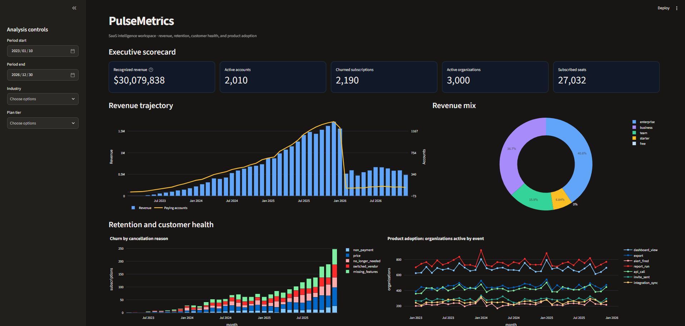
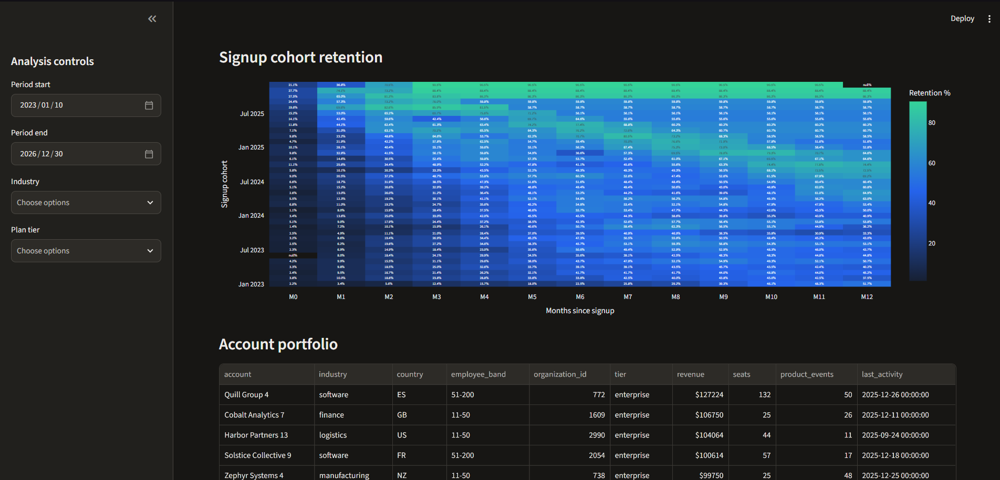
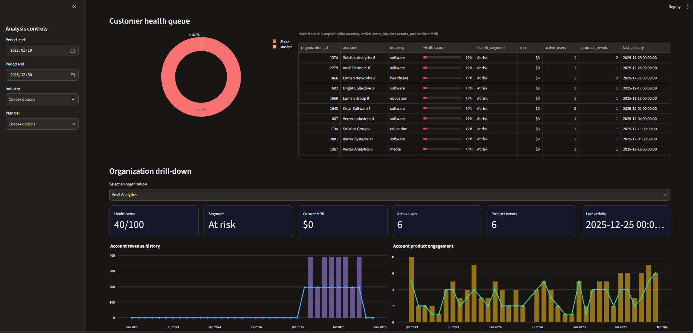

# PulseMetrics SaaS Analytics

An end-to-end B2B SaaS analytics project for revenue growth, churn, retention, customer segmentation, and product usage. Source data is stored as Parquet, the analytical layer uses DuckDB SQL, and the implemented interactive dashboard uses Streamlit. The curated SQL views are also structured for a Power BI semantic model.

**Live dashboard:** [Open PulseMetrics on Streamlit](https://eddashkurti-pulsemetrics-saas-analytics-dashboardapp-gxmb71.streamlit.app/)

## Portfolio highlights

- `$30.1M` recognized revenue across the source invoice history.
- `2,010` currently active accounts and `27,032` subscribed seats in the executive model.
- Cohort retention connects signup quality to long-term customer value.
- Explainable customer-health scoring prioritizes accounts using recency, users, product events, and MRR.
- The organization drill-down turns portfolio signals into account-level renewal actions.

The main business takeaway is to pair revenue concentration with product engagement: high-value accounts with weak recent activity should receive proactive Customer Success attention before renewal risk becomes visible in churn totals.

## Dashboard preview

### Executive scorecard



### Retention and account portfolio



### Customer health and organization drill-down



## Repository layout

- `data/` — source Parquet files.
- `sql/00_load_data.sql` — loads Parquet into DuckDB tables.
- `sql/01_data_quality.sql` — uniqueness, null, referential-integrity, and range checks.
- `sql/02_metrics.sql` — reusable revenue, activity, churn, and KPI views.
- `sql/03_analytics_model.sql` — curated subscription-month, account-metric, revenue-bridge, and customer-health model.
- `sql/04_retention_analysis.sql` — cohort retention and segment-retention views.
- `dashboard/app.py` — interactive Streamlit dashboard.
- `docs/metric_definitions.md` — metric definitions and analytical assumptions.
- `docs/entity_relationships.md` — curated model grains and relationships.
- `docs/powerbi_measures.md` — Power BI measure specification.
- `docs/data_quality_issue_log.md` — transparent issue register and remediation plan.
- `reports/metric_validation_report.md` — generated metric reconciliation summary.
- `reports/portfolio_case_study.md` — portfolio narrative, insights, decisions, and limitations.
- `reports/` — portfolio evidence and dashboard handoff.
- `powerbi/` — Power BI model guidance; the committed `pulsemetrics.pbix` is the report deliverable.

## Quick start

Install [DuckDB](https://duckdb.org/docs/installation/) and run from the repository root:

```text
duckdb pulsemetrics.duckdb -c ".read sql/00_load_data.sql"
duckdb pulsemetrics.duckdb -c ".read sql/01_data_quality.sql"
duckdb pulsemetrics.duckdb -c ".read sql/02_metrics.sql"
duckdb pulsemetrics.duckdb -c ".read sql/03_analytics_model.sql"
duckdb pulsemetrics.duckdb -c ".read sql/04_retention_analysis.sql"
```

Or rebuild and validate the complete model with Python:

```text
py -3.13 scripts/build_model.py
py -3.13 scripts/run_quality_checks.py
```

The SQL uses repository-relative paths and works after cloning on Windows, macOS, or Linux. The generated `pulsemetrics.duckdb` database and WAL files are ignored by Git.

## Metrics

`sql/02_metrics.sql` creates `monthly_revenue`, `organization_revenue`, `monthly_active_organizations`, and `churn_summary` views, followed by a compact KPI query for dashboard cards or CSV export.

Launch the interactive dashboard with:

```text
py -3.13 -m pip install -r requirements.txt
py -3.13 -m streamlit run dashboard/app.py
```

The dashboard includes executive KPIs, revenue mix, churn reasons, product adoption, cohort retention, account portfolio analysis, and an explainable customer-health queue. The `sql/03_analytics_model.sql` and `sql/04_retention_analysis.sql` views provide the clean source layer for the committed `pulsemetrics.pbix` Power BI report.

See the full portfolio narrative in [`reports/portfolio_case_study.md`](reports/portfolio_case_study.md).

The committed Power BI file is a presentation artifact. Power BI Desktop does not run in GitHub Actions, so refreshability is validated through the Parquet inputs, DuckDB SQL model, Python checks, and generated metric report rather than by executing the binary `.pbix` in CI.

GitHub Actions runs Python compilation, the data-quality suite, and analytical-model regression tests on every push and pull request.

The quality suite reports 23 known source date anomalies (`ended_on` before `started_on`) as warnings. Raw source files are preserved unchanged; curated model invariants must pass with zero failures.

## Data quality

Run the data-quality script before using the metrics. It checks duplicate IDs, required fields, invalid date ranges, negative invoice amounts, and orphaned foreign keys. Queries that return rows identify records requiring investigation; all other checks should return zero violations.

## Reproducibility

The committed `pulsemetrics.pbix` is the versioned presentation deliverable. The local DuckDB database, WAL file, notebook checkpoints, and raw staging files are generated or transient artifacts and are not committed. Rebuild the local database from the versioned Parquet inputs and SQL scripts whenever needed.
