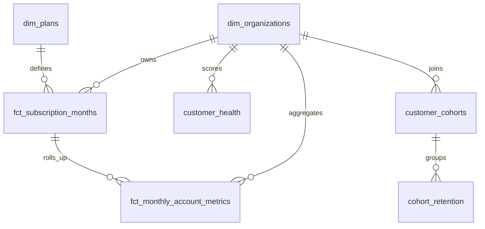

# PulseMetrics analytical model

## Model grains

- `dim_organizations`: one row per organization.
- `dim_plans`: one row per plan.
- `fct_subscription_months`: one row per active subscription per calendar month.
- `fct_monthly_account_metrics`: one row per organization per month with observed revenue and product activity.
- `customer_health`: one latest snapshot per organization.
- `cohort_retention`: one row per signup cohort and month since signup.

Raw Parquet tables remain available for auditability; dashboard queries should use the curated views.
