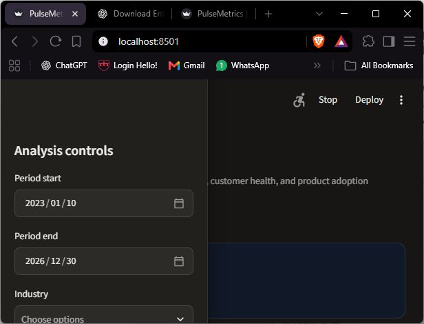
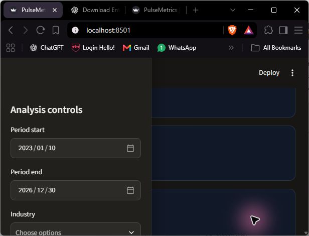

# Portfolio evidence

The primary portfolio narrative is [`portfolio_case_study.md`](portfolio_case_study.md). The live visuals are available through:

- Streamlit: `py -3.13 -m streamlit run dashboard/app.py`
- Power BI Desktop: open [`pulsemetrics.pbix`](../pulsemetrics.pbix)

## Rendered evidence

