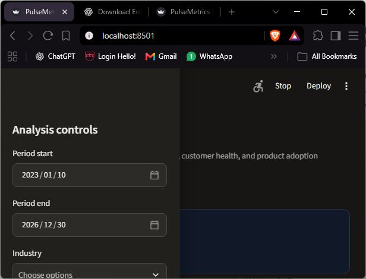
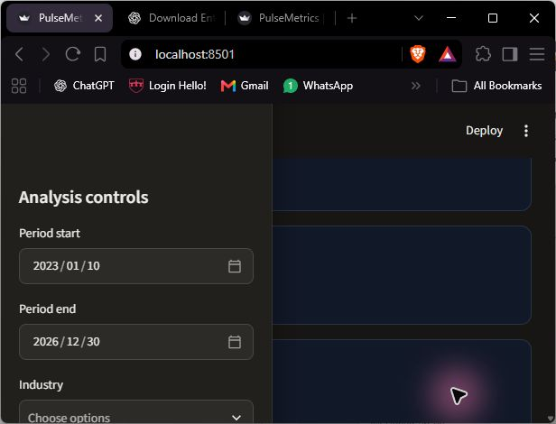

# PulseMetrics SaaS Analytics — Portfolio Case Study

## Executive summary

PulseMetrics is an end-to-end B2B SaaS revenue-operations workspace. It turns subscription, invoice, organization, user, plan, and product-event data into a decision layer for leadership, finance, customer success, and product teams.





The project answers four practical questions:

1. Is recurring revenue growing, and which plan tiers drive it?
2. Where are customers churning, and what is the retention pattern by signup cohort?
3. Which accounts are commercially important but operationally at risk?
4. Is product engagement supporting subscription value?

## Analytical approach

Parquet source files are loaded into DuckDB. Reusable SQL models create a subscription-month fact table, account-month metrics, revenue bridge, customer-health scores, and cohort-retention tables. Streamlit provides the reproducible local dashboard; `pulsemetrics.pbix` provides the Power BI presentation deliverable.

The model uses explicit grains and documented measures so revenue, MRR, active accounts, churn, retention, usage, and health are not mixed across incompatible levels of detail.

## Dashboard pages and decisions

### Executive scorecard

Shows recognized revenue, active accounts, churned subscriptions, active organizations, and subscribed seats. Leadership can filter by period, industry, and plan tier.

### Revenue and mix

The revenue trajectory combines monthly billed revenue with paying-account volume. Revenue mix identifies concentration by plan tier and supports packaging or pricing discussions.

### Retention and adoption

Churn reasons, signup-cohort retention, and monthly active organizations by event type connect commercial outcomes to product behavior.

### Customer health queue

The health score is explainable rather than a black box: recency, active users, product events, and current MRR contribute to the score. Customer Success can prioritize low-score accounts with high commercial exposure.

### Organization drill-down

Selecting an account exposes current health, MRR, users, events, last activity, revenue history, and engagement history. This creates a direct path from portfolio-level signal to account-level action.

## Recommended actions enabled by the analysis

- Prioritize high-MRR accounts with declining activity for proactive renewal outreach.
- Investigate churn reasons by plan tier and industry before changing packaging.
- Use cohort retention to distinguish acquisition-quality issues from product adoption issues.
- Pair expansion opportunities with sustained user and event growth rather than revenue alone.

## Limitations and assumptions

- Source data contains 23 subscriptions where `ended_on` precedes `started_on`; these records remain unchanged and are reported as warnings.
- Invoice status values `paid` and `active` are treated as recognized revenue for dashboard purposes.
- Health scoring is an operational prioritization signal, not a validated machine-learning probability of churn.
- Cohort retention is organization-based and measured by active subscription presence in each month.
- The data is a static portfolio dataset; no live refresh or production credentials are required.

## Reproduce the project

```powershell
py -3.13 -m pip install -r requirements.txt
py -3.13 scripts/build_model.py
py -3.13 scripts/run_quality_checks.py
py -3.13 -m streamlit run dashboard/app.py
```

See [`docs/metric_definitions.md`](../docs/metric_definitions.md), [`docs/entity_relationships.md`](../docs/entity_relationships.md), and [`powerbi/README.md`](../powerbi/README.md) for implementation detail.
